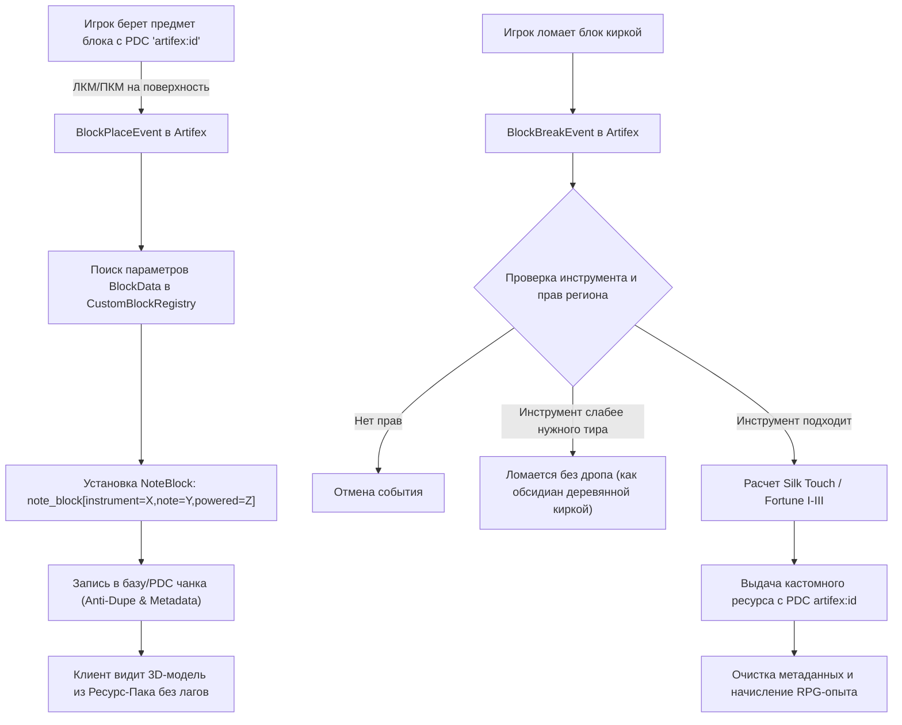

# ТЕХНИЧЕСКИЙ ДИЗАЙН СИСТЕМЫ КАСТОМНЫХ БЛОКОВ В PAPER 26.3
**Модуль:** `me.dcplugin.artifex.blocks` (Artifex Block Engine)  
**Архитектура:** Note Block State Carrier Matrix (NBSCM) + Display Decorators  
**Совместимость:** Minecraft Java 26.3 (Paper / Purpur), 100% Ванильный клиент (без Fabric/Forge)

---

## 1. АРХИТЕКТУРНЫЙ ПРИНЦИП

Для создания сотен кастомных руд, минералов и декоративных блоков на чистом Paper-сервере без требования клиентских модов применяется проверенный временем серверно-клиентский стандарт: **Note Block State Mapping**.



### Преимущества матрицы Note Block:
1. **800 уникальных вариантов состояний:** 16 инструментов (`harp`, `bass`, `snare`, `hat`, `basedrum`, `bell`, `flute`, `chime`, `guitar`, `xylophone`, `iron_xylophone`, `cow_bell`, `didgeridoo`, `bit`, `banjo`, `pling`) $\times$ 25 полутонов (`0..24`) $\times$ 2 состояния питания (`powered=true/false`).
2. **0 лагов и тиков:** Блоки рендерятся видеокартой клиента как стандартный куб/модель чанка. Никаких ArmorStand или Display-сущностей в шахтах.
3. **Идеальная физика:** Честная коллизия (игрок не проваливается), правильное освещение, поддержка теней и ambient occlusion.
4. **Совместимость с Iris Worldgen:** Iris может размещать эти блоки напрямую во время генерации мира!

---

## 2. МАТРИЦА РАСПРЕДЕЛЕНИЯ СОСТОЯНИЙ (STATE ALLOCATION)

Каждому семейству блоков выделяется отдельный инструмент нотного блока:

| Инструмент (`instrument`) | Диапазон `note` | Состояние `powered` | Категория блоков | Емкость |
|---|---|---|---|---|
| `iron_xylophone` | 0 – 24 | false | Базовые руды (Common/Uncommon Ores) | 25 блоков |
| `iron_xylophone` | 0 – 24 | true | Глубинные руды (Deepslate Ores) | 25 блоков |
| `bell` | 0 – 24 | false | Редкие магические руды (Rare / Epic Ores) | 25 блоков |
| `chime` | 0 – 24 | false | Кристальные друзы и кластеры | 25 блоков |
| `guitar` | 0 – 24 | false | Слитки / Хранилища (Storage Blocks) | 25 блоков |
| `flute` | 0 – 24 | false | Рунные и древние камни (Ancient & Runestones) | 25 блоков |
| `xylophone` | 0 – 24 | false | Огненные и магматические породы | 25 блоков |
| `didgeridoo` | 0 – 24 | false | Пустотные и абиссальные породы | 25 блоков |

---

## 3. СЕРВЕРНЫЙ ДВИЖОК: `CustomBlockEngine`

### 3.1. Регистрация кастомного блока (Java API / YAML)
Каждый блок описывается структурой:
```java
public class CustomBlockDef {
    private final String id;               // e.g. "artifex:ember_ore"
    private final String nameRu;           // e.g. "Руда Пламени"
    private final Instrument instrument;   // Instrument.IRON_XYLOPHONE
    private final int note;                // 0..24
    private final boolean powered;         // false
    private final ToolType requiredTool;   // ToolType.PICKAXE
    private final MiningTier minTier;      // MiningTier.IRON
    private final float hardness;          // 3.5f (время ломания)
    private final String dropItemId;       // "artifex:ember_essence_raw"
    private final int minDrop;             // 1
    private final int maxDrop;             // 2
    private final int expDrop;             // 5..10
    private final boolean affectedByFortune; // true
}
```

### 3.2. Обработчики событий (Event Listeners)

1. **`BlockPlaceListener`:**
   - Проверяет `PDC` предмета в руке на ключ `artifex:id`.
   - Если это кастомный блок, устанавливает `NoteBlock` с параметрами `(instrument, note, powered)`.
   - В `ChunkPersistentDataContainer` или SQLite по ключу `world_x_y_z` записывается флаг `placed_by_player = true` (защита от дюпа опыта и ресурсов через установку и повторное выкапывание).

2. **`PlayerInteractListener`:**
   - При `Action.RIGHT_CLICK_BLOCK` по нотному блоку: если блок зарегистрирован в реестре Artifex, событие отменяется (`event.setCancelled(true)`), предотвращая переключение ноты ванильным клиентом.

3. **`BlockBreakListener`:**
   - Проверяет права региона (`WorldGuard.canBreak`, `GriefPrevention`).
   - Проверяет инструмент в руке: если кирка ниже `minTier`, блок ломается, но дроп не выпадает (как обсидиан рукой).
   - Если на кирке `Шелковое касание` (`Silk Touch`) $\rightarrow$ выпадает сам блок в виде предмета (`CustomBlockDef.getItem()`).
   - Если на кирке `Удача` (`Fortune I-III`):
     $$\text{Количество} = \text{random}(minDrop, maxDrop) \times \text{FortuneMultiplier}$$
   - Начисляется опыт (`Player.giveExp(exp)`).
   - Звук и частицы: проигрывается кастомный звук разлома руды (`block.stone.break` / `block.amethyst_block.break`) и спавнятся частицы (пыль соответствующего цвета).

4. **Глушение ванильных звуков нотного блока:**
   - Перехват события воспроизведения ноты (`NotePlayEvent`), отмена события для всех зарегистрированных кастомных блоков.

---

## 4. СТРУКТУРА РЕСУРС-ПАКА ДЛЯ КАСТОМНЫХ БЛОКОВ

### 4.1. `assets/minecraft/blockstates/note_block.json`
В файл маппинга состояний добавляются блоки Artifex:
```json
{
  "variants": {
    "instrument=iron_xylophone,note=0,powered=false": {
      "model": "artifex:block/ore_ember"
    },
    "instrument=iron_xylophone,note=1,powered=false": {
      "model": "artifex:block/ore_frost"
    },
    "instrument=iron_xylophone,note=2,powered=false": {
      "model": "artifex:block/ore_storm"
    },
    "instrument=iron_xylophone,note=3,powered=false": {
      "model": "artifex:block/ore_void"
    },
    "instrument=guitar,note=0,powered=false": {
      "model": "artifex:block/block_ember_storage"
    }
  }
}
```

### 4.2. Модели блоков (`assets/artifex/models/block/`)
Стандартные кубы и объемные 3D-модели (для кристаллов и рунных монолитов):
```json
{
  "parent": "minecraft:block/cube_all",
  "textures": {
    "all": "artifex:block/ore_ember"
  }
}
```

---

## 5. ИНТЕГРАЦИЯ С IRIS WORLDGEN

Iris генерирует блоки прямо по их состоянию BlockState:
В конфигурациях жил руд (`packs/overworld/features/ores/*.json`):
```json
{
  "type": "iris:ore",
  "block": "minecraft:note_block[instrument=iron_xylophone,note=0,powered=false]",
  "target": "minecraft:stone",
  "size": 8,
  "count": 12,
  "min-y": 0,
  "max-y": 96
}
```
Это гарантирует, что руда спавнится естественным образом в горах, пещерах и гротах Iris сразу в виде нашего кастомного блока!
